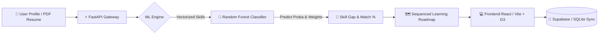

<div align="center">

# 🎯 SkillGap AI

### *Bridging the Chasm Between Current Abilities and Career Aspirations*

An intelligent, full-stack career acceleration platform powered by Machine Learning.  
SkillGap AI analyzes your current capabilities, pinpoints missing competencies, and generates dynamic, milestone-driven learning roadmaps tailored to your target tech role.

---

[](https://www.python.org/)
[](https://fastapi.tiangolo.com/)
[](https://react.dev/)
[](https://vitejs.dev/)
[](https://scikit-learn.org/)
[](https://supabase.com/)
[](LICENSE)

<br/>

[✨ Features](#-key-features) •
[🏗️ Architecture](#%EF%B8%8F-system-architecture) •
[📊 Model Benchmark](#-model-performance) •
[🚀 Quick Start](#-quick-start) •
[📡 API Reference](#-api-endpoints) •
[🚢 Deployment](#-deployment)

---

</div>

## 💡 Overview

Landing modern tech roles is often hindered by misaligned learning paths and vague industry expectations. **SkillGap AI** bridges this gap using a calibrated **Random Forest ML engine** combined with an intuitive **React + D3.js** interface.

From uploading your resume to testing code in an interactive sandbox, SkillGap AI provides a hyper-personalized roadmap with real-time feedback and tracking.

---

## ✨ Key Features

<table>
  <tr>
    <td width="50%">
      <h3>🧠 ML Fit Assessment</h3>
      <p>Instant skill-match percentage powered by an ensemble Random Forest classifier calibrated on industry-vetted skill weights.</p>
    </td>
    <td width="50%">
      <h3>🗺️ Dynamic Learning Roadmaps</h3>
      <p>Staged learning milestones (<em>Foundational → Intermediate → Applied</em>) with curated learning modules, projects, and benchmarks.</p>
    </td>
  </tr>
  <tr>
    <td width="50%">
      <h3>📄 Resume & JD Analyzer</h3>
      <p>Extract technical competencies from PDF resumes and match profile readiness against real-world job descriptions in seconds.</p>
    </td>
    <td width="50%">
      <h3>📈 Market Insights & Analytics</h3>
      <p>Visualize emerging skill trends, salary benchmarks, and tech-stack demands tailored across 16 modern developer roles.</p>
    </td>
  </tr>
  <tr>
    <td width="50%">
      <h3>💻 Interactive Code Sandbox</h3>
      <p>Experiment, validate code syntax, and test technical concepts directly within the web workspace without local tool friction.</p>
    </td>
    <td width="50%">
      <h3>📝 Skill Quizzes & Progress Sync</h3>
      <p>Validate your growth through role-based diagnostic quizzes and synchronize completion states via SQLite / Supabase.</p>
    </td>
  </tr>
</table>

---

## 🏗️ System Architecture



---

## 🧭 Supported Roles & Pathways

SkillGap AI currently supports comprehensive skill taxonomies across **16 industry tracks**:

<details open>
<summary><b>Click to expand / collapse all supported roles</b></summary>

<br/>

| Domain | Supported Roles |
|:---|:---|
| **Data & AI** | 🤖 Data Scientist • 🧠 ML Engineer • 🔮 AI Engineer • 🗄️ Data Engineer |
| **Web & Mobile** | 🎨 Frontend Developer • ⚙️ Backend Developer • 🌐 Full Stack Developer • 📱 Mobile App Developer |
| **Cloud & Security** | ☁️ Cloud Engineer • 🔄 DevOps Engineer • 🛡️ Cybersecurity Analyst • 🧪 QA / Automation Engineer |
| **Specialized Tech** | ☕ Java Developer • ⛓️ Blockchain Developer • 🎮 Game Developer • 🔌 Embedded Systems Engineer |

</details>

---

## 📊 Model Performance

Evaluated on stratified test sets across industry skill combinations, comparing ensemble models against standard baselines:

| Model Architecture | Accuracy | Precision | Recall | F1-Score | Status |
|:---|:---:|:---:|:---:|:---:|:---:|
| **Random Forest** *(Deployed)* | **90.6%** | **92.7%** | **90.4%** | **91.5%** | 🟢 **Production** |
| **Support Vector Machine (SVM)** | 91.2% | 91.3% | 93.2% | 92.2% | 🟡 Evaluation |
| **Naive Bayes** | 80.2% | 82.7% | 81.8% | 82.2% | ⚪ Baseline |

> [!NOTE]
> **Why Random Forest for Production?**  
> While SVM demonstrates comparable raw accuracy, Random Forest provides well-calibrated class probability distributions via `predict_proba`. These probabilities directly drive the high-precision **Match Gauge** on the student dashboard.

---

## 📂 Project Structure

```bash
SkillGap-AI/
├── 📁 backend/                # FastAPI application & business logic
│   ├── main.py               # API entry point & CORS configuration
│   ├── routes/               # Modular route handlers (quiz, resume, jd, roadmap, etc.)
│   └── requirements.txt      # Backend Python dependencies
├── 📁 ml/                     # Machine Learning engine & pipelines
│   ├── preprocessing.py      # Feature extraction & MultiLabelBinarizer
│   ├── train_model.py        # Model training & hyperparameter tuning
│   ├── evaluate.py           # Evaluation benchmarks & metrics
│   └── model_artifacts/      # Serialized models (.pkl) & metadata
├── 📁 data/
│   └── processed/            # Role taxonomy JSON + generated dataset CSV
└── 📁 frontend/               # Modern React (Vite) client application
    ├── src/
    │   ├── components/       # Reusable UI elements (MatchGauge, VisualRoadmap, etc.)
    │   ├── pages/            # View pages (Dashboard, Explore, Sandbox, Planner)
    │   └── api/              # Axios HTTP client & Supabase integrations
    └── package.json          # Frontend dependencies & scripts
```

---

## 🚀 Quick Start

### 📋 Prerequisites

Ensure you have the following installed on your environment:
- **Python 3.11+**
- **Node.js 18+** & **npm**

---

### 1️⃣ Backend Setup

```bash
# Clone the repository
git clone https://github.com/your-username/SkillGap-AI.git
cd SkillGap-AI

# Install Python dependencies
pip install -r backend/requirements.txt

# (First Time Only) Generate data taxonomy & train the ML model
python -m ml.preprocessing
python -m ml.train_model

# Launch the FastAPI development server
uvicorn backend.main:app --reload --port 8000
```

> [!TIP]
> Once running, explore the interactive Swagger documentation at:  
> 🔗 **`http://localhost:8000/docs`**

---

### 2️⃣ Frontend Setup

Open a separate terminal window:

```bash
# Navigate to frontend directory
cd frontend

# Install dependencies
npm install

# Start Vite development server
npm run dev
```

🌐 The frontend will be live at: **`http://localhost:5173`**  
*(Vite automatically proxies `/api/*` calls to the local FastAPI port 8000).*

---

## 📡 API Endpoints

<details open>
<summary><b>Core API Routes</b></summary>

<br/>

| Method | Endpoint | Description |
|:---:|:---|:---|
| `GET` | `/health` | Service health check |
| `POST` | `/api/skillgap` | Computes match percentage and prioritizes missing skills |
| `POST` | `/api/roadmap` | Generates a sequenced, stage-wise learning roadmap |
| `GET` | `/api/roles` | Retrieves all 16 supported technical career tracks |
| `GET` | `/api/roles/{role_name}` | Detailed skill breakdown for a given role |
| `POST` | `/api/resume/parse` | Extracts technical skills and metadata from PDF resume |
| `POST` | `/api/jd/match` | Compares candidate profile against a job description |
| `GET` | `/api/market/trends` | Fetches real-time industry skill demand & statistics |
| `POST` | `/api/quiz/generate` | Generates diagnostic technical quizzes |
| `POST` | `/api/progress` | Saves milestone progress (SQLite / Supabase) |
| `GET` | `/api/progress/{student_id}/{role}` | Retrieves completed and pending modules |

</details>

### 🧪 Example Request

```bash
curl -X POST http://localhost:8000/api/skillgap \
  -H "Content-Type: application/json" \
  -d '{
    "current_skills": ["Python", "SQL", "Pandas"],
    "target_role": "Data Scientist",
    "projects": ["EDA Housing Prices"],
    "experience_level": "Intermediate"
  }'
```

---

## 🚢 Deployment

### 🟢 Backend (Render)
1. Link your GitHub repository to [Render](https://render.com).
2. Create a new **Web Service**.
3. Configure the settings:
   - **Build Command:** `pip install -r backend/requirements.txt && python -m ml.train_model`
   - **Start Command:** `uvicorn backend.main:app --host 0.0.0.0 --port $PORT`
   - **Root Directory:** `./`

### 🟣 Frontend (Vercel / Netlify)
1. Import repository to [Vercel](https://vercel.com) or [Netlify](https://netlify.com).
2. Configure project settings:
   - **Root Directory:** `frontend`
   - **Build Command:** `npm run build`
   - **Output Directory:** `dist`
3. Environment Variables:
   - `VITE_API_URL`: `https://your-backend-service.onrender.com`

---

## ⚙️ ML Architecture & Pipeline

- **Dataset**: Synthetic & curated dataset of 8,000+ candidate profiles spanning 16 roles and 120+ technical competencies.
- **Vectorization**: `MultiLabelBinarizer` for skills, `LabelEncoder` for target role and career levels.
- **Classifier**: Random Forest (`n_estimators=200`, `max_depth=15`, `class_weight='balanced'`).
- **Sequencer**: Weighted-topological priority algorithm sorting skills into clear, achievable stages (*Foundational → Intermediate → Applied*).

---

## 👨‍💻 Contributors

The project was developed by:

- **Aryan Lade**
- **Tanvir Kanoje**
- **Mohammad Anas**
- **Sayyad Rehan**

---

## 🤝 Contributing

Contributions are what make the open-source community thrive!
1. Fork the Project
2. Create your Feature Branch (`git checkout -b feature/AmazingFeature`)
3. Commit your Changes (`git commit -m 'Add some AmazingFeature'`)
4. Push to the Branch (`git push origin feature/AmazingFeature`)
5. Open a Pull Request

---

<div align="center">

Made with ❤️ for students, career switchers, and engineers worldwide.  
**SkillGap AI** — *Empowering your career roadmap.*

</div>
